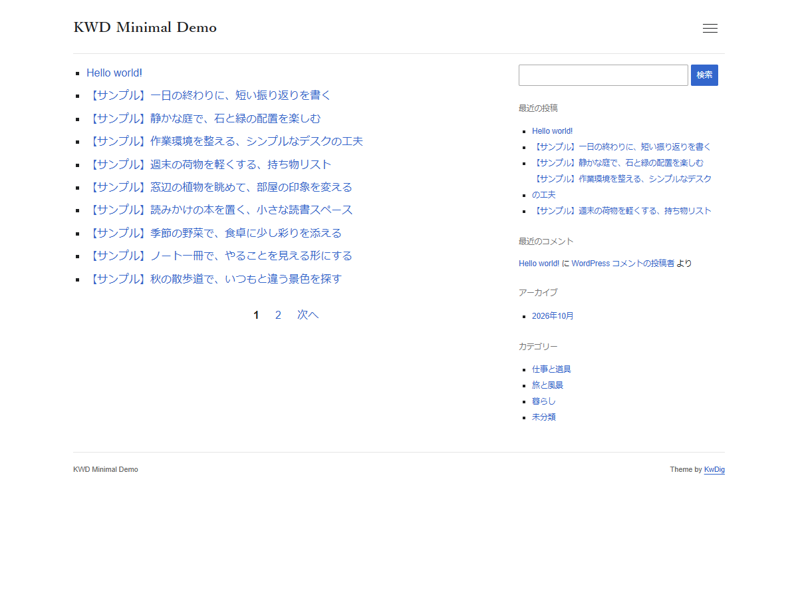

# KWD Minimal

白背景とコンパクトな文字組みの、シンプルなFC2ブログ風WordPressテーマです。**Version 1.0.33**。

[紹介・ダウンロード](https://kwdig.com/kwd-minimal) · [デモ](https://kwdig.com/kwd-minimal/demo/) · [インストール用ZIP](https://github.com/kwdig/kwd-minimal/releases/latest/download/kwd-minimal.zip)

## 主な機能

- PCは本文最大640px・間隔20px・右サイドバー320px。サイドバー未設定なら本文640pxの中央寄せ。
- 画面幅1000px以下では1カラムに切り替わり、サイドバーは本文の下に表示。
- PC・スマホともにハンバーガーメニューを使用。検索欄とナビゲーションをまとめて表示。
- 記事一覧は四角いマーカー付きのタイトルリンクのみ。通常のページ番号で移動。
- 記事末尾に同カテゴリー優先の関連記事を最大10件表示。
- 「ホーム » 親カテゴリー » 子カテゴリー »」形式のパンくず。
- ブログタイトルは明朝体、本文・記事タイトル・見出しはゴシック体。
- WordPress標準のウィジェット、固定ページ、コメント、記事内改ページ、パスワード保護に対応。
- 外部ライブラリや外部フォントを読み込まないクラシックテーマ。

## インストール

1. [最新リリースのkwd-minimal.zip](https://github.com/kwdig/kwd-minimal/releases/latest/download/kwd-minimal.zip)をダウンロードします。
2. WordPress管理画面の「外観 → テーマ → 新しいテーマを追加 → テーマのアップロード」で、ZIPを解凍せず選択します。
3. インストール後に「有効化」を選びます。

GitHubの自動生成ZIPではなく、リリースに添付した **kwd-minimal.zip** を使用してください。マルチサイトでは、ネットワーク管理でインストールした後、使用するサイトでテーマを有効化します。

既存テーマからの切り替えでは、ウィジェットとメニューの表示位置を確認してください。広告コード・プラグインとの組み合わせは各サイトで確認が必要です。

## 設定

- **記事一覧**：「設定 → 表示設定」でトップページと表示件数を設定します。
- **メニュー**：「外観 → メニュー」で表示位置「ハンバーガーメニュー」に割り当てます。未設定時はホームと固定ページを表示します。
- **右サイドバー**：「外観 → ウィジェット」の「右サイドバー（広告300×300対応）」にブロックを追加します。300×300の広告を置ける実幅300pxの領域があります。
- **1カラム**：右サイドバーを空にすると切り替わります。
- **検索**：メニュー内に固定表示します。サイドバー検索はWordPressの検索ブロックを追加して利用できます。
- **コメント**：WordPress標準設定に従います。使わない場合はディスカッション設定と既存投稿のコメント設定を無効にします。

## 文字とリンク

| 対象 | 指定 |
|---|---|
| 本文 | 16px、行間1.75 |
| 記事タイトル | 24px |
| 本文H1 / H2 / H3 | 22px / 18px / 16px |
| 関連記事・コメントの見出し | 18px、薄い下線 |
| サイドバーの本文・見出し | 11.7px |
| 通常リンク / 訪問済みリンク | 青 #3366CC / 紫 #6A60B0 |
| em | 斜体なしの太字 |
| strong | 濃い赤 #C4483B の太字 |

本文のフォント指定は Noto Sans Japanese → ヒラギノ角ゴシック → Arial → メイリオの順です。端末にあるフォントを使用し、フォントファイルの配信は行いません。

通常リンクの下線はホバー時に表示します。サイトタイトルはホバー時も下線なしで文字色のみ変化し、フッターのクレジットリンクには識別しやすいよう常時下線を付けます。

## アクセシビリティ

本文へのスキップリンク、入力ラベル、名前付き検索ランドマーク、キーボードフォーカス、Escapeで閉じられるメニューを用意しています。検索欄はマウスでクリックした際の強調枠を抑え、Tabキーで操作する際はフォーカスを表示します。

v1.0.28のデモトップページは、手元のLighthouse 13.6.0のモバイル検査でユーザー補助100点でした。全ユーザー・全ページの利用可能性を保証するものではなく、ウィジェットや記事内容によって結果は変わります。

## 動作要件と検証

WordPress 6.4以上 / PHP 7.4以上。WordPress 7.1.4、PHP 8.3 / 8.5、Chromeで主要な表示・操作を確認しています。最低対応バージョンの組み合わせでは実機検証していません。

## ライセンス

GPL-2.0-or-later。詳細は[LICENSE](LICENSE)をご覧ください。デモ記事・画像・サイトの設定・認証情報は配布テーマに含みません。

## 更新履歴

- **1.0.33**：ヘッダー下・フッター上の区切り線を画面の左右端まで拡張。本文幅と余白は維持。

- **1.0.32**：フッターのKwDigリンクを新しいタブで開くよう変更。

- **1.0.31**：小さなテーマCSSをHTML内にまとめ、テーマJavaScriptをdeferで実行。初期描画時の外部CSS待ちを削減。

- **1.0.30**：GitHub公開用の情報、説明書、スクリーンショットを更新。
- **1.0.29**：サイドバーの文字サイズを11.7pxに調整。
- **1.0.28**：リンクの識別性、強調文字のコントラスト、検索の読み上げ用ラベルを改善。

過去の変更点は[readme.txt](readme.txt)をご覧ください。
