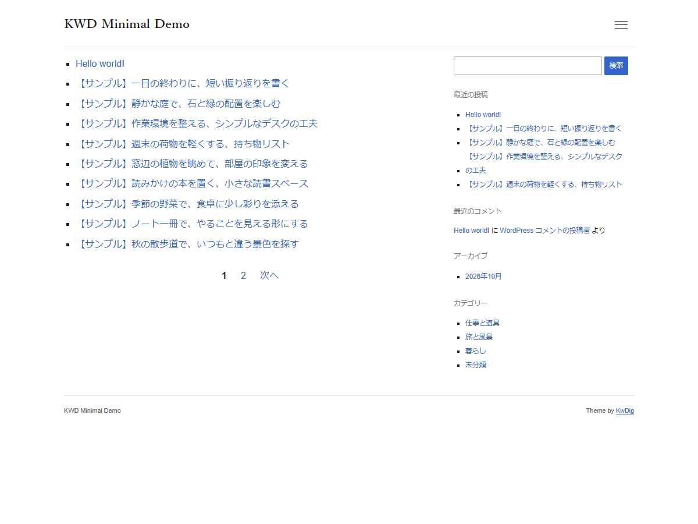

# KWD Minimal

白背景とコンパクトな文字組みの、シンプルなFC2ブログ風WordPressテーマです。**Version 1.0.38**。

[紹介・ダウンロード](https://kwdig.com/kwd-minimal) · [デモ](https://kwdig.com/kwd-minimal/demo/) · [インストール用ZIP](https://github.com/kwdig/kwd-minimal/releases/latest/download/kwd-minimal.zip)



## 主な機能

- PCは本文最大640px・間隔20px・右サイドバー320px。サイドバー未設定なら本文640pxの中央寄せ。
- 画面幅1000px以下では1カラムに切り替わり、サイドバーは本文の下に本文と同じ幅で表示。
- PC・スマホともにハンバーガーメニューを使用。検索欄とナビゲーションをまとめて表示。
- 記事一覧は四角いマーカー付きのタイトルリンクのみ。通常のページ番号で移動。
- 記事末尾に同カテゴリー優先の関連記事を最大10件表示。
- 「ホーム » 親カテゴリー » 子カテゴリー »」形式のパンくず。
- ブログタイトルは明朝体、本文・記事タイトル・見出しはゴシック体。
- WordPress標準のウィジェット、固定ページ、コメント、記事内改ページ、パスワード保護に対応。
- `[copy_block]` による、右上のコピーボタン付きテキスト枠。
- 外部ライブラリや外部フォントを読み込まないクラシックテーマ。

## インストール

1. [最新リリースのkwd-minimal.zip](https://github.com/kwdig/kwd-minimal/releases/latest/download/kwd-minimal.zip)をダウンロードします。
2. WordPress管理画面の「外観 → テーマ → 新しいテーマを追加 → テーマのアップロード」で、ZIPを解凍せず選択します。
3. インストール後に「有効化」を選びます。

GitHubの自動生成ZIPではなく、リリースに添付した **kwd-minimal.zip** を使用してください。マルチサイトでは、ネットワーク管理でインストールした後、使用するサイトでテーマを有効化します。

既存テーマからの切り替えでは、ウィジェットとメニューの表示位置を確認してください。広告コード・プラグインとの組み合わせは各サイトで確認が必要です。

## 設定

- **記事一覧**：「設定 → 表示設定」でトップページと表示件数を設定します。
- **メニュー**：「外観 → メニュー」で表示位置「ハンバーガーメニュー」に割り当てます。未設定時はホームと固定ページを表示します。
- **右サイドバー**：「外観 → ウィジェット」の「右サイドバー（広告300×300対応）」にブロックを追加します。300×300の広告を置ける実幅300pxの領域があります。
- **1カラム**：右サイドバーを空にすると切り替わります。
- **検索**：メニュー内に固定表示します。サイドバー検索はWordPressの検索ブロックを追加して利用できます。
- **コメント**：WordPress標準設定に従います。使わない場合はディスカッション設定と既存投稿のコメント設定を無効にします。

## コピー枠の使い方

v1.0.38から、チャットのコード枠風のコピーボタンを標準搭載しています。追加プラグインは不要です。

投稿・固定ページの編集画面で「ショートコード」ブロックを追加し、次のように入力します。

```text
[copy_block]
コピーする文章をここに入力します。

改行を含め、枠内の全文をコピーできます。
[/copy_block]
```

- 枠の右上の「コピー」を押すと、ボタンや見出しを含めずに枠内の全文をコピーします。長い文章は枠内でスクロールできます。
- 成功時はチェックアイコンと「コピーしました」を表示し、約2秒後に元へ戻ります。
- 1記事に複数設置できます。`[copy_block label="内容をコピー"]...[/copy_block]` でボタン名も指定できます。
- 従来の `[copy_block]` と互換です。前後の余白を除去し、段落・brタグを改行に整え、HTMLタグを除いて実体参照を復元します。HTMLを文字としてコピーする場合は `&lt;`・`&gt;` のように入力してください。
- HTTPSではClipboard APIを利用し、利用できない場合は代替方式を試します。失敗時は本文を選択してコピーしてください。JavaScriptが無効でも本文は表示・選択できます。
- キーボードでボタンを操作でき、コピー結果を読み上げ向けにも通知します。枠内のスクロール領域にもフォーカスできます。
- 専用CSS・JavaScriptはコピー枠を使うページで読み込みます。通常の記事や一覧には追加しません。
- 別のプラグインが同名のショートコードを登録済みの場合、テーマはその登録を上書きしません。既存のコピー用プラグインが優先される場合は、その機能を停止してテーマ側へ切り替えてください。

## メタディスクリプションの仕様と設定方法

v1.0.36から、ページの概要を検索エンジンへ伝えるメタディスクリプションに対応しています。記事本文中には表示されません。基本は自動生成で、必要なページだけ手動設定できます。外部AIやAPIは使用しません。

### ページごとの出力ルール

| ページの種類 | 使用する説明文 |
|---|---|
| 投稿・固定ページ | 手動の説明文 → 手動の抜粋 → 本文からの自動抜粋 |
| トップページ：最新の投稿 | トップ用の説明文 → サイトのキャッチフレーズ |
| トップページ：固定ページ | その固定ページの説明文 → 抜粋 → 本文 |
| 別に指定した投稿一覧ページ | 投稿一覧用の説明文 → サイトのキャッチフレーズ |
| カテゴリー・タグ一覧 | 管理画面の「説明」欄のみ。空欄なら出力しません |
| 著者・日付別一覧、検索結果、404 | 出力しません |
| パスワード保護記事 | 出力しません |

本文からの生成にはWordPress標準の `get_the_excerpt()` を使います。手動の抜粋があればそれを使用し、なければ本文から生成します。HTMLタグ・余分な空白・末尾の `[…]` を除き、**手動入力した説明文も含めて最大120文字**に整えます。内容が空になった場合は、空のmetaタグも出力しません。

### 1．投稿・固定ページに説明文を設定する

1. 管理画面の「投稿」または「固定ページ」で、対象の記事を編集します。
2. 編集画面の **「メタディスクリプション」欄**に、そのページを紹介する文章を入力します。
3. 記事を保存または更新します。入力した説明文が、抜粋・本文より優先されます。

空欄にして保存すると、抜粋・本文からの生成に戻ります。同じ欄には、保存済みの抜粋・本文から作る説明文の生成例も表示します。既存のカスタムフィールド `_kwd_meta_description` の値も引き継ぎます。

入力例：

> KWD Minimalの特徴と設定方法を紹介。レイアウト、メニュー、ウィジェットの使い方、ダウンロードと導入手順をまとめます。

### 2．抜粋を使って説明文を整える

個別の説明文を入力せずに調整したい場合は、記事編集画面の **「抜粋」欄**に短い紹介文を入力します。固定ページでも抜粋を利用できます。「メタディスクリプション」欄が空なら、この抜粋が使われます。

### 3．トップ・投稿一覧の説明文を設定する

1. **「外観 → カスタマイズ → メタディスクリプション」**を開きます。
2. 「トップページ（最新の投稿）の説明文」、または「別に指定した投稿一覧ページの説明文」を入力します。
3. カスタマイズ画面の **「公開」**を押して設定を保存します。

空欄なら「設定 → 一般」の **キャッチフレーズ**を使用します。キャッチフレーズも空なら出力しません。固定ページをトップに指定している場合は、ここに入力したトップ用説明文ではなく、その固定ページの説明文・抜粋・本文を使用します。

### 4．カテゴリー・タグの説明文を設定する

**「投稿 → カテゴリー」または「投稿 → タグ」**で対象を編集し、**「説明」欄**に文章を入力して更新します。そのカテゴリー・タグの一覧ページに使用します。説明欄が空の場合、カテゴリー名・タグ名などからの補完は行いません。

### SEOプラグインの併用と出力の停止

Yoast SEO、Rank Math、All in One SEO、SEOPress、The SEO Frameworkを検出すると、テーマからの出力を止め、プラグイン側へ任せます。

別の方法で説明文を出力する場合や、テーマの機能を使わない場合は、「外観 → カスタマイズ → メタディスクリプション」の **「テーマから説明文を出力する」**のチェックを外し、「公開」で保存してください。

### 自動生成の扱い

自動生成は文章の要約ではなく、抜粋の取り出しです。表の項目名・コード・一覧の文字を含む場合や、120文字の上限で文章の途中までになる場合があります。紹介文を整えたいページでは、手動の説明文または抜粋を設定してください。元の記事本文や表を自動で書き換えることはありません。

検索結果の説明文は検索エンジンが判断するため、設定した文章が必ずそのまま表示されるわけではありません。

## 文字とリンク

| 対象 | 指定 |
|---|---|
| 本文 | 16px、行間1.75 |
| 記事タイトル | 24px |
| 本文H1 / H2 / H3 | 22px / 18px / 16px |
| 関連記事・コメントの見出し | 18px、薄い下線 |
| サイドバーの本文・見出し | 11.7px |
| 通常リンク / 訪問済みリンク | 青 #3366CC / 紫 #6A60B0 |
| em | 斜体なしの太字 |
| strong | 濃い赤 #C4483B の太字 |

本文のフォント指定は Noto Sans Japanese → ヒラギノ角ゴシック → Arial → メイリオの順です。端末にあるフォントを使用し、フォントファイルの配信は行いません。

通常リンクの下線はホバー時に表示します。サイトタイトルはホバー時も下線なしで文字色のみ変化し、フッターのクレジットリンクには識別しやすいよう常時下線を付けます。

## アクセシビリティ

本文へのスキップリンク、入力ラベル、名前付き検索ランドマーク、キーボードフォーカス、Escapeで閉じられるメニューを用意しています。検索欄はマウスでクリックした際の強調枠を抑え、Tabキーで操作する際はフォーカスを表示します。

v1.0.28のデモトップページは、手元のLighthouse 13.6.0のモバイル検査でユーザー補助100点でした。全ユーザー・全ページの利用可能性を保証するものではなく、ウィジェットや記事内容によって結果は変わります。

## 動作要件と検証

WordPress 6.4以上 / PHP 7.4以上。WordPress 7.1.4、PHP 8.3 / 8.5、Chromeで主要な表示・操作を確認しています。最低対応バージョンの組み合わせでは実機検証していません。

## ライセンス

GPL-2.0-or-later。詳細は[LICENSE](LICENSE)をご覧ください。デモ記事・画像・サイトの設定・認証情報は配布テーマに含みません。

## 更新履歴

- **1.0.38**：コピー枠をテーマ標準機能として追加。既存ショートコードと互換、本文・改行を保持。

- **1.0.37**：メタディスクリプションの仕様表と管理画面での設定手順をREADME・readme.txtに追記。機能の仕様は変更なし。

- **1.0.36**：メタディスクリプションの自動生成・手動入力、トップ／投稿一覧の設定、SEOプラグインとの重複回避を追加。

- **1.0.35**：記事一覧・関連記事・サイドバーで、複数行に折り返した項目の四角いマーカーを1行目に揃えるよう修正。

- **1.0.34**：画面幅1000px以下で、本文の下に移動したサイドバーを本文と同じ幅に変更。

- **1.0.33**：ヘッダー下・フッター上の区切り線を画面の左右端まで拡張。本文幅と余白は維持。

- **1.0.32**：フッターのKwDigリンクを新しいタブで開くよう変更。

- **1.0.31**：小さなテーマCSSをHTML内にまとめ、テーマJavaScriptをdeferで実行。初期描画時の外部CSS待ちを削減。

- **1.0.30**：GitHub公開用の情報、説明書、スクリーンショットを更新。
- **1.0.29**：サイドバーの文字サイズを11.7pxに調整。
- **1.0.28**：リンクの識別性、強調文字のコントラスト、検索の読み上げ用ラベルを改善。

過去の変更点は[readme.txt](readme.txt)をご覧ください。
